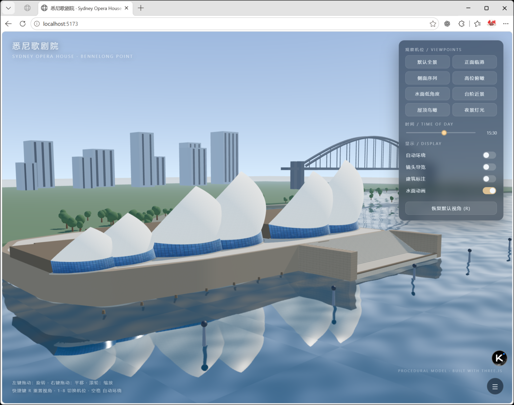

# 悉尼歌剧院 · Sydney Opera House — Three.js 交互场景

一个以**悉尼歌剧院**为主体的可交互 3D 场景：建筑完全由代码程序化建模（未加载任何现成模型），
临港而立，配以真实平面反射的港湾水面、大台阶、玻璃幕墙、远景天际线与海港大桥。



## 快速开始

```bash
# 1. 安装依赖（Node 18+ 推荐）
npm install

# 2. 启动开发服务器（默认 http://localhost:5173）
npm run dev

# 3. 生产构建（输出到 dist/）
npm run build

# 4. 本地预览构建产物
npm run preview
```

页面加载后直接进入完整场景，无需任何额外操作。

## 交互说明

| 操作 | 说明 |
| --- | --- |
| 左键拖动 | 自由旋转 |
| 右键拖动 | 平移 |
| 滚轮 | 缩放 |
| `R` 键 / 面板按钮 | 恢复默认视角 |
| `1`–`8` 数字键 | 快速切换 8 个预设机位 |
| `空格` | 自动环绕开关 |

面板功能：

- **观察机位**：默认全景 / 正面临港 / 侧面序列 / 高位俯瞰 / 水面低角度 / 台阶近景 / 屋顶鸟瞰 / 夜景灯光（镜头平滑过渡）
- **时间**：5:00–24:00 连续变化，太阳方位、天空颜色、雾色、水色、环境反射随之更新；入夜后幕墙窗光、
  壳体洗墙灯、港口灯桩、天际线窗光自动点亮
- **显示**：自动环绕、镜头导览（自动巡回机位）、建筑信息标注（CSS2D 标签）、水面动画开关

## 建筑建模要点

**壳体（核心）** —— 依据 Utzon 的"球面解"：

- 每片壳体由 **顶点 A、底角 B/C、底边中点** 四点唯一确定一个球面（实际拟合半径约 55–75 m，
  与真实歌剧院 75 m 球面半径同量级），曲面因此具有恒定正曲率、外凸内凹；
- 底边为球面与基面交线（水平圆弧），侧边为球面上的大圆弧，顶点收拢成尖；
- 生成外表面、内表面与加厚边缘，保证体积感与边缘高光；
- 三组壳体（音乐厅 → 歌剧厅 → 餐厅）体量依次减小，沿轴线排布并相互叠压，
  全部朝水面倾斜，形成标志性的"帆群"序列。

**整体关系**：

- 基座（Podium）：花岗岩主体自水面升起，顶部为铺装平台；
- 大台阶：24 级宽阔台阶向水面展开，带侧墙与临水平台、系缆桩；
- 玻璃幕墙：严格贴合每片壳体的球面底边下垂至基座平台，带竖挺/横档分格与夜间窗光；
- 滨水环境：基于 `Reflector` 的实时平面反射水面 + 波浪法线扰动 + 菲涅尔 + 太阳波光，
  建筑、天际线与船只真实倒映于水中；岸线地形、树木、渡轮/帆船、港口灯桩、
  远景天际线与海港大桥构成完整港湾空间。

## 项目结构

```
sydney-opera-house/
├─ index.html                 # 页面骨架与 UI 样式
├─ vite.config.js
└─ src/
   ├─ main.js                 # 渲染器、相机、交互、动画主循环
   ├─ config.js               # 尺度、壳体分组、机位等参数
   ├─ textures.js             # 瓷砖/花岗岩/混凝土/水波法线（Canvas 程序化）
   ├─ geometry/
   │  └─ shell.js             # 球面壳体几何生成器（含底边弧、厚度与边缘）
   ├─ building/
   │  └─ operaHouse.js        # 基座、台阶、幕墙、壳体分组组装
   ├─ environment/
   │  ├─ sky.js               # 渐变天空、太阳、星空、时间系统
   │  ├─ water.js             # 反射水面（Reflector + 自定义着色器）
   │  └─ surroundings.js      # 地形、树木、天际线、海港大桥、船只、灯桩
   ├─ lighting/
   │  └─ lights.js            # 太阳/半球光/夜间亮化
   └─ textures/
      └─ glass.js             # 幕墙玻璃与夜间窗光纹理
```

## 技术栈

- Three.js `^0.169`（WebGL2）
- Vite `^5`（开发/构建）
- 纹理全部用 Canvas 程序化生成，无外部资源依赖；构建产物可直接静态部署（`base: './'`）

## 已验证内容

以下均在本机实际执行/浏览器实测（Edge）：

- `npm install`、`npm run dev`（http://localhost:5173）、`npm run build`、`npm run preview`（http://localhost:4173）全部执行成功；
  构建产物经 preview 服务器验证 `index.html` 与 JS bundle 均返回 HTTP 200 且可正常加载；
- 浏览器实测：页面加载即进入完整场景；鼠标拖动旋转、滚轮缩放、右键平移；
  「默认全景 / 正面临港 / 夜景灯光」等机位按钮与镜头平滑过渡；时间滑杆（含黄昏、夜晚的天空/水色/灯光联动）；
  自动环绕、建筑标注、水面动画开关；键盘 `R` 重置视角（拖动改变视角后按 R 已确认复位）；
- 逐角度截图检查了默认全景、正面临港、侧面序列、水面方向与夜景下的模型完整性、
  壳体曲面质量、基座/台阶/幕墙衔接与水面倒影构图。

未做系统验证的部分（如实说明）：

- 「高位俯瞰 / 台阶近景 / 屋顶鸟瞰」三个机位未逐一截图确认构图（代码与其余机位共用同一过渡逻辑）；
- 长时间运行的性能稳定性、不同显卡/浏览器兼容性未做系统测试。
